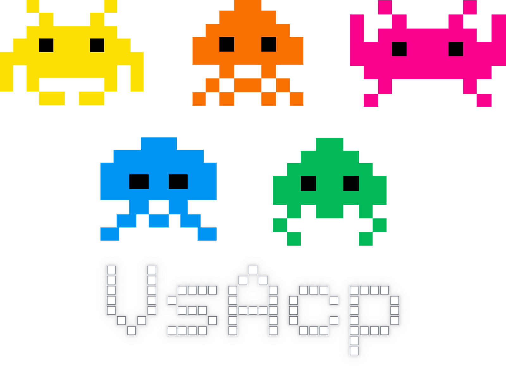
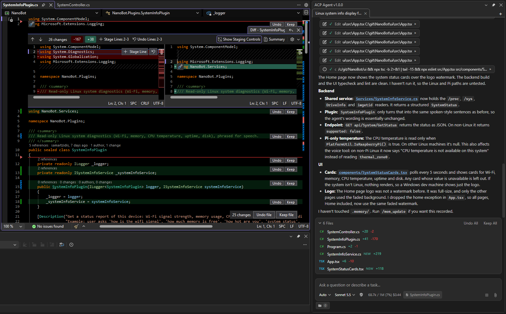
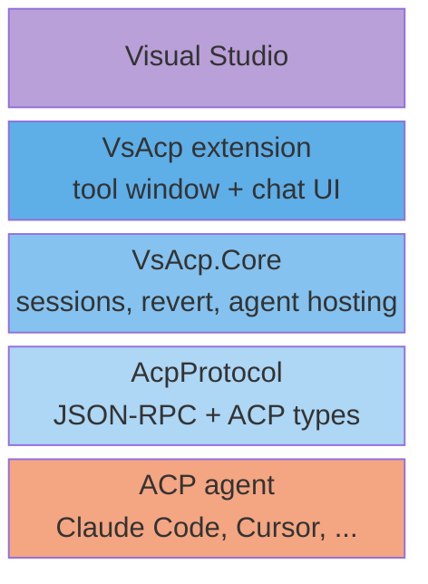

  

# Visual Studio ACP Agent

Integrate Claude Code, Cursor and other ACP-compliant agents directly into the Visual Studio IDE.

A Visual Studio extension that hosts AI coding agents - Claude Code, Cursor, or any other [Agent Client Protocol (ACP)](https://agentclientprotocol.com/) compliant agent - in a native chat tool window, integrating it to Visual Studio's files, editors, terminals, and permission system.

  

## Capabilities

- **Chat tool window** - multiple tabs, each a persistent session restored across VS restarts
- **Inline file diffs** - agent edits are written straight to disk and shown as a Keep/Undo overlay in the editor, with a pending-changes list grouping the agent's own edits apart from shell/build/user changes
- **Revert to here** - roll back a conversation and the workspace files it changed, via local shadow-git checkpoints; no project git repo required or touched
- **Fork from here** - continue a chat from any message in a new tab, leaving the original as it is
- **Agent presets** - Cursor, Claude Code or a **Custom** command line; the command and arguments can be overridden on any preset, each preset has its own list of environment variables (each row has an **Enabled** checkbox, and one setting switches them all off), and the composer toolbar shows the agent's logo
- **Permission prompts** - per-tab auto-approve toggle, plus mode/model selection and session config options the agent advertises
- **Elicitation** - renders an agent's structured form or URL request as an in-chat prompt
- **Terminal support** - runs and streams output for commands the agent executes
- **Extra folders** - share additional project folders with the agent beyond the solution folder
- **Attachments** - file drag-drop, image paste, and code-reference paste from the editor as chips
- **Slash commands** - agent-advertised commands as an inline picker
- **Visual Studio state for the agent** - opt-in read-only tools (**Tools \> Options \> ACP Agent \> Let the agent read Visual Studio's state**) that let the agent read the Output window panes (Build, Debug, Tests and others), the active and open documents with the caret and selection, the solution's configuration and startup project, and whether a build or the debugger is running; served to agents that support HTTP MCP servers

## Limitations

VsAcp tracks the **stable ACP v1 protocol**, not v2 or any unstable proposals:

- **Subagents** - no UI for agent-delegated subagent runs; subagent sessions are an unstable ACP proposal, not part of the stable schema
- **Message-level agent rollback** - the stable protocol has no way to rewind a session to an earlier message. "Revert to here" restores local files from a shadow-git checkpoint, and both it and "Fork from here" give the agent the earlier conversation through the unstable `session/fork` where the agent advertises it (Claude Code does); for agents that don't (Cursor), the agent is re-primed with the prior conversation as context instead of truly rewinding its own session state

Separately, two methods that *are* in the stable v1 schema aren't wired up yet:

- **Agent-driven authentication / `logout`** - sign in and out through the agent's own CLI rather than through VsAcp

## Requirements

- Visual Studio 2026 (18.10 or later)
- Node.js (build-time only, for the chat UI)
- An ACP-compliant agent CLI (e.g. Claude Code via its ACP bridge, Cursor's agent) configured under **Tools \> Options \> ACP Agent**

### Claude Code agent setup

The built-in **Claude Code** preset (**Tools \> Options \> ACP Agent**) runs `npx @agentclientprotocol/claude-agent-acp --yes`, so it needs:

- **Node.js / npm** on `PATH` - `npx` fetches and runs the bridge package on demand, no separate install required
- **The [Claude Code CLI](https://code.claude.com/docs/en/overview)** installed and signed in (`claude` on `PATH`, logged in via a Claude.ai subscription or an `ANTHROPIC_API_KEY`) - the bridge drives this CLI under the hood, so it needs its own working session

Run `claude` once from a terminal to install dependencies and complete login before using the preset in VsAcp.

### Cursor agent setup

The built-in **Cursor** preset (**Tools \> Options \> ACP Agent**) runs `agent acp`, so it needs the [Cursor CLI](https://docs.cursor.com/en/cli/installation) installed (`agent` on `PATH`) and signed in - browser login is the default, or set `CURSOR_API_KEY` for unattended use.

Run `agent login` once from a terminal to complete setup before using the preset in VsAcp.

### Custom agent setup

Choose the **Custom** preset (**Tools \> Options \> ACP Agent**) for any other ACP-compliant agent. It has no command of its own: fill in **Agent command** (required) and, if the agent needs them, **Agent arguments**. Variables the agent needs, such as an API key, go in **Custom agent environment variables**.

## Project layout

|Project|Purpose|
|:---|:---|
|[`src/AcpProtocol`](src/AcpProtocol/README.md)|JSON-RPC transport and generated ACP schema types|
|[`src/VsAcp.Core`](src/VsAcp.Core/README.md)|Agent process management, session/persistence/revert logic, independent of VS|
|`src/VsAcp`|The VSIX itself: a tool window that hosts a single WebView2 chat page (Preact/TypeScript) drawing the tabs and chats, plus the VS integration|
|`tools/AcpProtocolSchemaGenerator`|Generates `AcpProtocol`'s C# types from the official ACP JSON schema|
|`tests/`|Headless end-to-end tests against a scriptable fake ACP agent|

Build with `dotnet build VsAcp.slnx`, or use the tasks in `.vscode/tasks.json` to build and install into a VS Experimental instance.

## License

Copyright (C) 2026 George Samartzidis

This project is licensed under the [GNU AGPL v3.0](LICENSE).